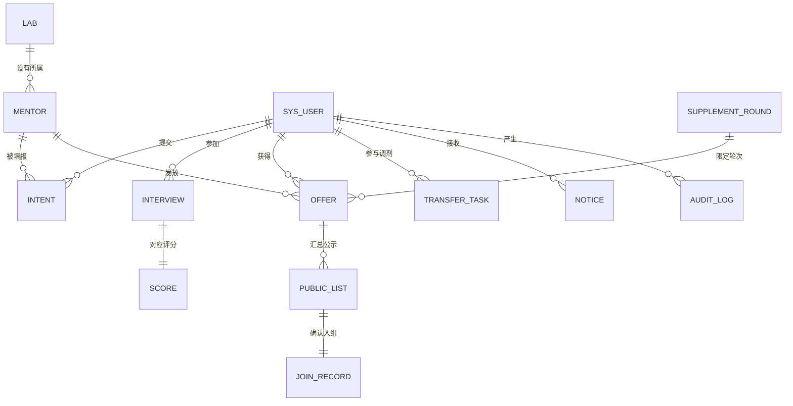

# 学生实训室选组选拔系统

面向学院实训室招新的全流程系统，覆盖 **宣讲/开放日 → 意向填报 → 面试 → 评分 → 拟录取 → 补录 → 公示 → 正式入组** 八个环节。

技术栈：Vue 3 + Vite + Element Plus ｜ Spring Boot 3.2 + MyBatis-Plus ｜ MySQL 8.0 ｜ JWT

---

## 数据库设计

### 1. 设计总览

- 库名：`zytbxt`，字符集 `utf8mb4`，共 **15 张表**
- 设计主线：**以「导师」为意向单位、以「时间窗」驱动全站开关、以「唯一键」承载业务规则**
- 状态字段统一使用英文枚举（如 `SUBMITTED/OFFERED/CONFIRMED/RELEASED`），避免魔法数字

### 2. ER 关系图



### 3. 表结构说明

| # | 表名 | 说明 | 关键约束 |
|---|------|------|----------|
| 1 | `sys_user` | 系统用户，四种角色共表 | `username` 唯一；`role` 区分 STUDENT/MENTOR/LAB_ADMIN/COLLEGE_ADMIN |
| 2 | `lab` | 实训室 | `code` 唯一；`quota_total` 总名额 |
| 3 | `mentor` | 导师，即意向填报单位 | `lab_id` 索引；`quota` 计划名额；`accept_cross_transfer` 是否接收跨室调剂 |
| 4 | `stage_window` | 八个环节的时间窗 | `stage_code` 唯一；`start_time/end_time` 驱动各环节开放与关闭 |
| 5 | `session_info` | 宣讲与开放日排期 | `type` 区分 BRIEFING/OPEN_DAY |
| 6 | `intent` | 学生意向（平行志愿，最多 3 个，不分先后） | `uk_stu_mentor_round(student_id, mentor_id, round_no)` 防重复填报 |
| 7 | `interview` | 面试场次安排 | `uk_interview(student_id, round_no)` 一人一轮仅一场 |
| 8 | `score` | 面试评分（态度/逻辑/编程基础/时间投入） | `interview_id` 唯一，一场面试一份评分 |
| 9 | `offer` | 拟录取 / 递补 / 内部调剂候选 | `uk_offer(student_id, mentor_id, round_no, type)` 防重复发放 |
| 10 | `supplement_round` | 分轮补录（第 2、3 轮） | `round_no` 唯一；`open_flag` 控制本轮是否开放 |
| 11 | `transfer_task` | 统筹调剂记录 | `priority` 1 内部 / 2 跨室 / 3 约谈安置 |
| 12 | `public_list` | 公示名单 | 记录公示时间、异议截止、异议内容 |
| 13 | `join_record` | 正式入组记录 | `uk_join_stu(student_id)` 一人只能入组一次 |
| 14 | `notice` | 站内通知 | `idx_notice_user(user_id, read_flag)` 支撑未读查询 |
| 15 | `audit_log` | 操作留痕 | `idx_audit_time(create_time)` 支撑按时间检索 |

### 4. 关键设计取舍

**① 唯一键即业务规则**

把业务约束下沉到数据库，避免依赖应用层判断：

- `intent.uk_stu_mentor_round`：同一轮不能重复填报同一导师
- `offer.uk_offer`：同一轮同一类型不能重复发 offer
- `join_record.uk_join_stu`：一人只能正式入组一次
- `score.interview_id UNIQUE`：一场面试只有一份评分

**② 时间窗驱动，而非硬编码日期**

`stage_window` 的 8 条记录决定每个环节的开关状态，学院管理员改时间即可调整全站流程，无需改代码或重新部署。

**③ 意向以导师为单位**

学生填报的对象是导师（`mentor_id` + `lab_id` 冗余），而非实训室。这样面试、评分、名额都直接挂在导师维度，避免"实训室内再分配"的二次计算。

**④ 冗余 `lab_id` 换取查询效率**

`intent`、`offer`、`score` 等表同时存 `mentor_id` 与 `lab_id`，虽存在冗余，但实训室维度的统计（各室报名数、录取数）无需多表 JOIN。

**⑤ 调剂三优先级**

`transfer_task.priority` 用 1/2/3 表达"室内调剂 → 跨室调剂 → 约谈安置"的降级顺序，与流程图一一对应。

### 5. 索引策略

| 索引 | 用途 |
|------|------|
| `intent.idx_intent_lab(lab_id, round_no)` | 按实训室+轮次统计报名情况 |
| `offer.idx_offer_stu(student_id, status)` | 学生端查询自己的录取状态 |
| `offer.idx_offer_mentor(mentor_id, type, status)` | 导师端查询待确认名单 |
| `interview.uk_interview` | 防止重复安排面试 |
| `notice.idx_notice_user(user_id, read_flag)` | 未读消息计数 |
| `audit_log.idx_audit_time(create_time)` | 按时间范围审计 |

### 6. 初始化

```bash
mysql -uroot -p < db/schema.sql   # 建库建表（15 张）
mysql -uroot -p < db/seed.sql     # 种子数据（49 用户 / 4 实训室 / 12 导师 / 8 环节）
```

后端连接配置见 `backend/src/main/resources/application.yml`，支持通过 `DB_URL`、`DB_USERNAME`、`DB_PASSWORD` 环境变量覆盖。
